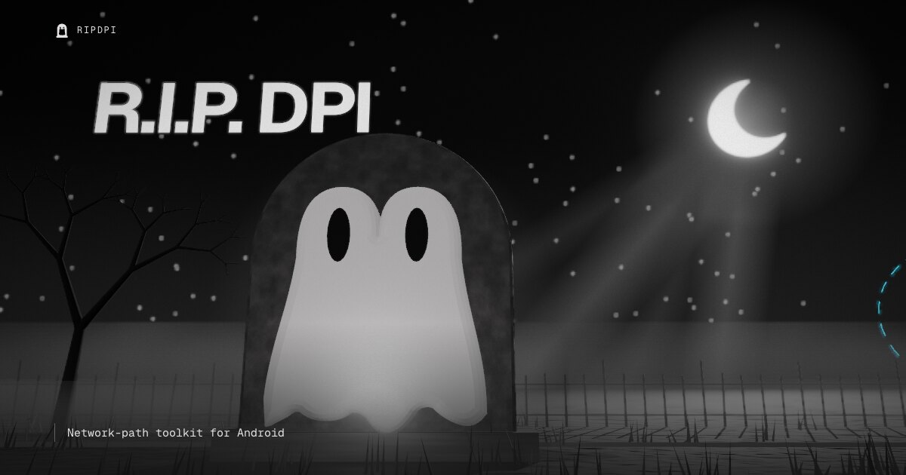

<div align="center">


# ripdpi-site

**The landing page for [RIPDPI](https://github.com/po4yka/RIPDPI), the network-path toolkit for Android.**

[](https://github.com/po4yka/ripdpi-site/actions/workflows/ci.yml)
[](https://ripdpi.dev)
[](https://github.com/po4yka/ripdpi-site/commits/main)
[](https://github.com/po4yka/RIPDPI/releases/latest)

[](https://react.dev)
[](https://reactrouter.com)
[](https://r3f.docs.pmnd.rs)
[](https://gsap.com)
[](https://tailwindcss.com)
[](https://www.typescriptlang.org)
[](https://workers.cloudflare.com)
[](https://www.conventionalcommits.org)

[**ripdpi.dev**](https://ripdpi.dev) · [Download the app](https://github.com/po4yka/RIPDPI/releases/latest) · [App source](https://github.com/po4yka/RIPDPI)



</div>

## What it is

One scroll, one night, one 3D landscape. The page retells the onboarding of the RIPDPI app as a walk past film-set props: the ghost of the app icon, the R.I.P. DPI tombstone, the wall with its scanner, the checkpoint, the posts with lamps, the tunnel. Each stop is a chapter:

| Chapter | Caption | What it says |
| --- | --- | --- |
| `rip` | R.I.P. DPI | A network-path toolkit for Android |
| `wall` | Everything gets scanned. | Deep packet inspection stops plain packets at the wall |
| `checkpoint` | Names, sealed. | Encrypted DNS: DoH, DoT, DNSCrypt, DoQ |
| `trouble` | Find the break. | Diagnostics show where the path fails |
| `connect` | One tap. | A local VPN or proxy |
| `night` | Always on. | Relays you control; ours are invite-only |
| `get` | Get RIPDPI | The download |

The captions live in [`app/story/chapters.ts`](app/story/chapters.ts).

## Works everywhere

- **No JavaScript:** the page is prerendered to HTML at build time, so the full story and the download link are there before any script runs.
- **No WebGL:** the story is drawn as animated SVG line art instead of the 3D scene.
- **Reduced motion:** every animation stops under `prefers-reduced-motion: reduce`.
- **Strict security headers:** a hashed script CSP, COOP and friends in [`public/_headers`](public/_headers). The build writes the hashes of the inline scripts into the policy.

## Stack

| Layer | Tools |
| --- | --- |
| Framework | React 19, React Router 8 in framework mode (`ssr: false`, `prerender: ["/"]`) |
| 3D | three.js, React Three Fiber, drei, postprocessing (lazy-loaded after hydration) |
| Motion | GSAP with ScrollTrigger through `@gsap/react` |
| Styles | Tailwind CSS 4; colour tokens follow the app's Kotlin theme |
| Hosting | Cloudflare Worker with static assets only, on `ripdpi.dev` |

## Quick start

You need Node.js 26 (see [`.nvmrc`](.nvmrc)).

```bash
npm ci
```

```bash
npm run dev
```

| Script | Does |
| --- | --- |
| `npm run dev` | Starts the local dev server |
| `npm run build` | Builds `build/client/` and writes the CSP hashes |
| `npm run preview` | Serves the build with Vite |
| `npm run typecheck` | Generates route types and runs `tsc` |
| `npm run lint` | Runs ESLint |
| `npm run check` | Typecheck, lint and build. Run it before every commit |

`npm run dev` does not send the security headers. To check the CSP, serve the build with Wrangler and watch the browser console:

```bash
npm run build && npx wrangler dev
```

## Project layout

```
app/
  routes/home.tsx    the only page
  story/             chapters, captions, SVG drawings, scroll progress
  scene/             the 3D landscape: stations, props, shots, captions, effects
  lib/environment.ts WebGL and reduced-motion hooks (safe prerender values)
  styles/tokens.css  design tokens from the app theme
public/              headers, favicon, Open Graph image, robots, sitemap, llms.txt
scripts/             build-time CSP hashing
```

## Deploy

[CI](.github/workflows/ci.yml) runs on every pull request and push: commitlint, `npm run check`, `npm audit` and a Wrangler dry run. A push to `main` deploys `build/client/` to Cloudflare with `wrangler deploy` ([`wrangler.jsonc`](wrangler.jsonc)). The `production` environment needs the `CLOUDFLARE_API_TOKEN` and `CLOUDFLARE_ACCOUNT_ID` secrets.

## Contributing

- Commits follow [Conventional Commits](https://www.conventionalcommits.org). Git hooks run ESLint and commitlint locally.
- Read [`AGENTS.md`](AGENTS.md) before you change the scene or the design: it holds the night lighting rules, the colour token rules and the content rules.
- The relay service is invite-only. Do not add provider names, regions, hostnames or other relay details to the site or this repository.
